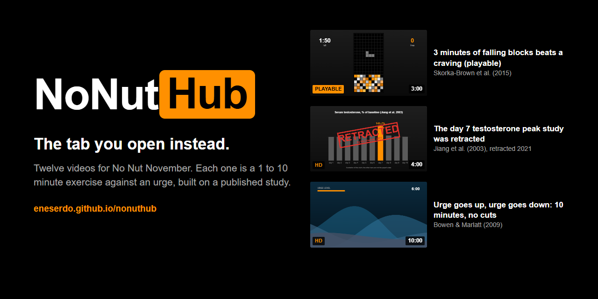
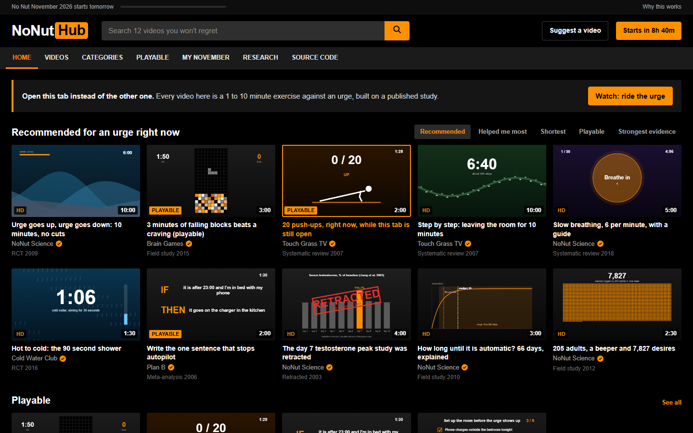
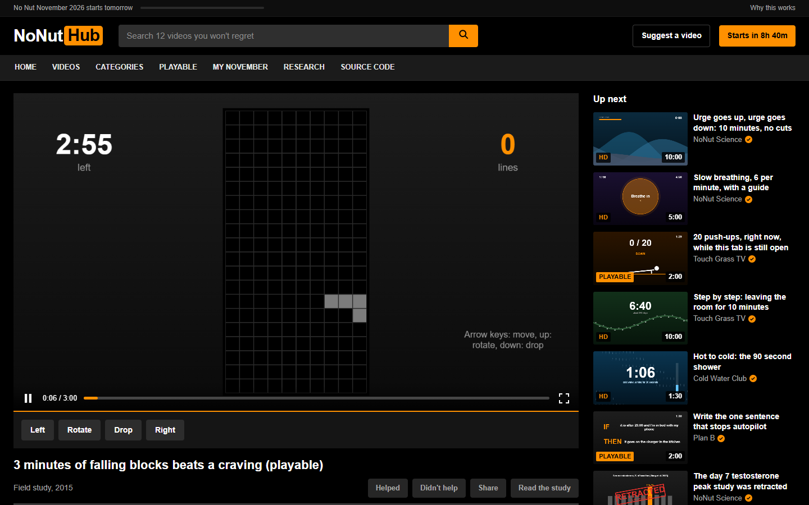
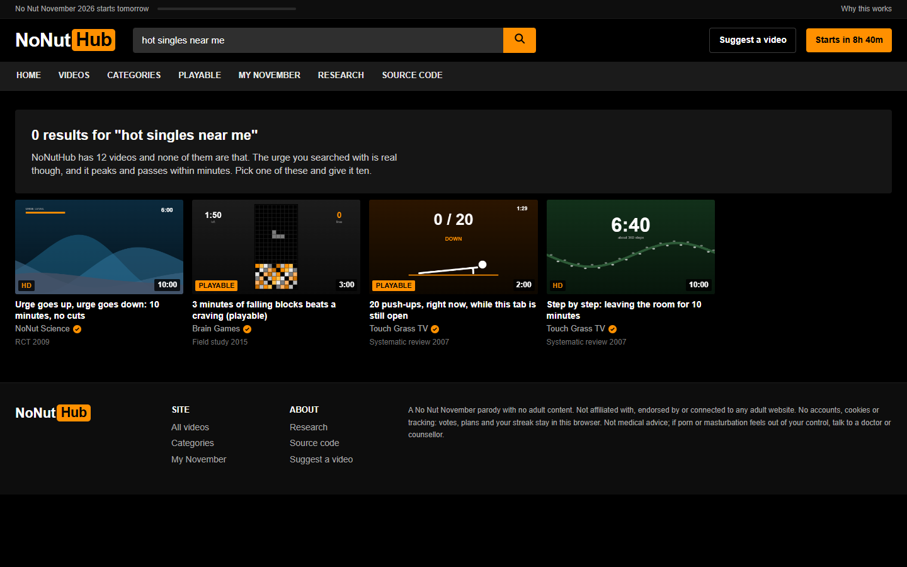
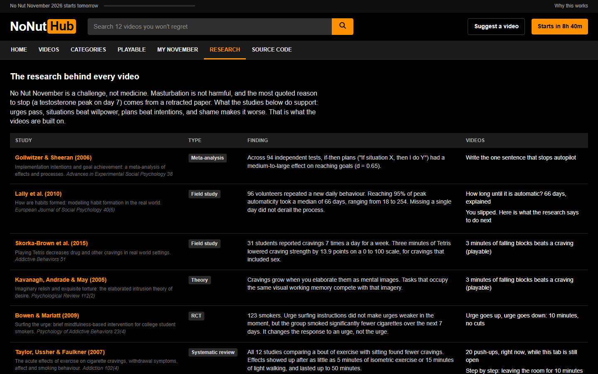
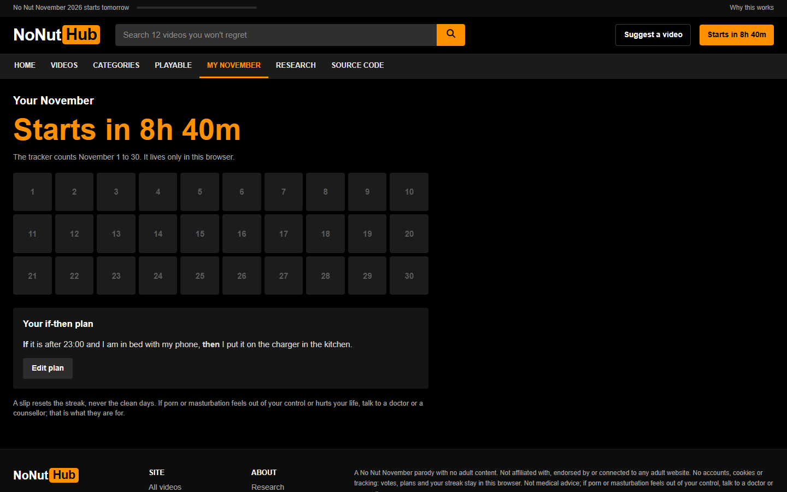
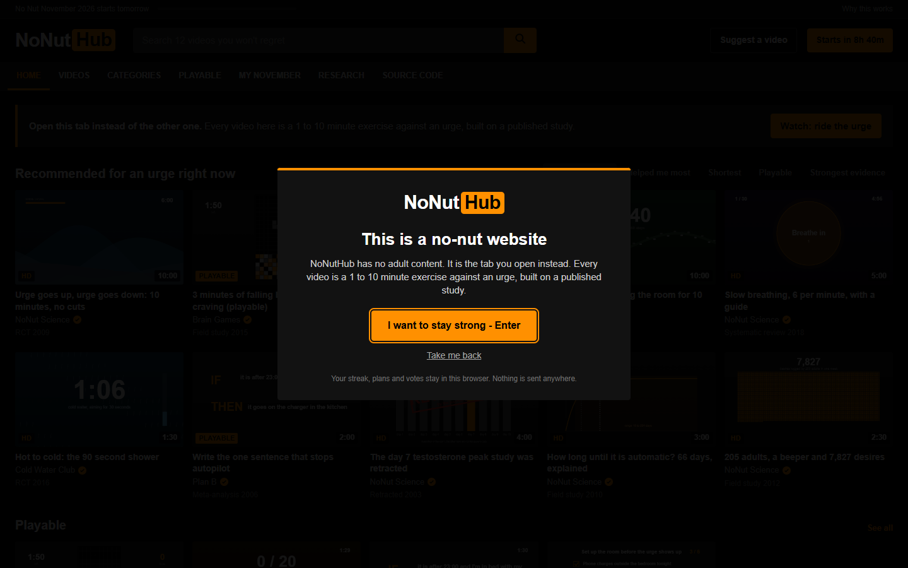
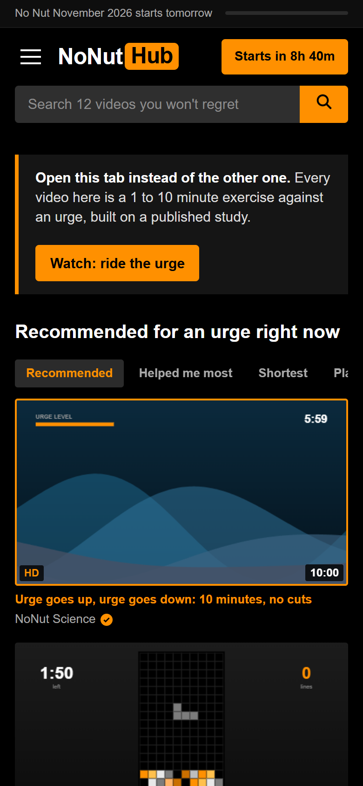
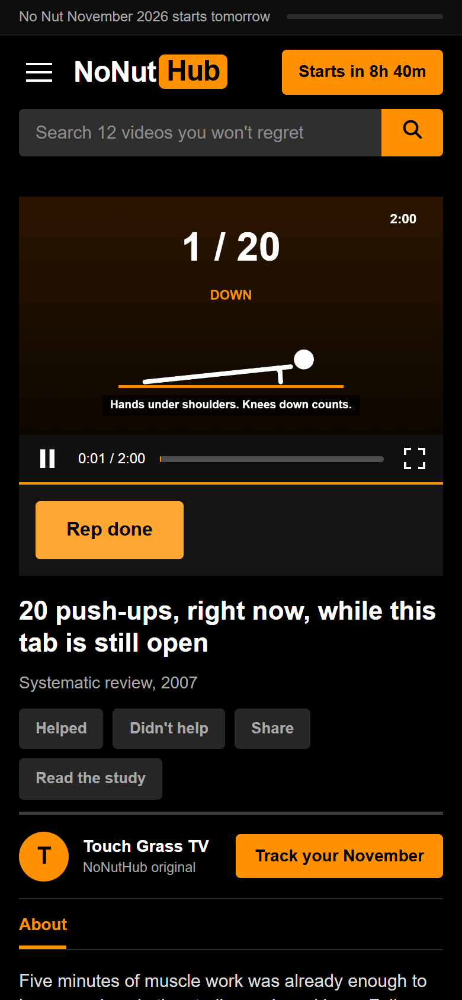

<p align="center">
  
</p>

<h3 align="center">The tab you open instead. Twelve study-backed videos for No Nut November, zero adult content.</h3>

<p align="center">
  <a href="https://eneserdo.github.io/nonuthub/"></a>
  
  
  
  <a href="LICENSE"></a>
</p>

<p align="center">
  <a href="https://eneserdo.github.io/nonuthub/"><b>Open NoNutHub</b></a> ·
  <a href="https://eneserdo.github.io/nonuthub/#/watch/blocks">play 3 minutes of falling blocks</a> ·
  <a href="https://eneserdo.github.io/nonuthub/#/research">read the research</a>
</p>

---

NoNutHub looks like the site you were about to open: black and orange, a search bar, a grid of thumbnails with
durations and HD badges, a player with an orange progress bar. Every video is something else. Each one is a 1 to 10
minute exercise that runs in your browser (an urge-surfing wave, a playable block game, a push-up counter, a cold
shower timer, an if-then planner) and each one is built on a published study, linked by DOI under the player.

## Preview

<table>
  <tr>
    <td width="50%"><br><sub><b>Home.</b> The familiar grid. Every thumbnail is a frame of the real exercise and plays a preview on hover.</sub></td>
    <td width="50%"><br><sub><b>Player.</b> Three minutes of falling blocks, the dose that lowered cravings in Skorka-Brown et al. (2015).</sub></td>
  </tr>
  <tr>
    <td><br><sub><b>Search.</b> Whatever you type, you get the exercises instead.</sub></td>
    <td><br><sub><b>Research.</b> Thirteen studies, what each found, and which videos use it.</sub></td>
  </tr>
  <tr>
    <td><br><sub><b>My November.</b> A 30-day calendar and your if-then plan. A slip resets the streak, never the clean days.</sub></td>
    <td><br><sub><b>Entry dialog.</b> "This is a no-nut website."</sub></td>
  </tr>
</table>

<p align="center">
  &nbsp;&nbsp;&nbsp;
  
</p>

## The videos

| Video | Length | What you do | Built on |
|---|---|---|---|
| [Urge goes up, urge goes down](https://eneserdo.github.io/nonuthub/#/watch/urge-wave) | 10:00 | Watch an urge wave rise and fall with prompts, do nothing else | Bowen & Marlatt 2009 |
| [3 minutes of falling blocks](https://eneserdo.github.io/nonuthub/#/watch/blocks) | 3:00 | Play a block game (keyboard or touch) | Skorka-Brown et al. 2015, Kavanagh et al. 2005 |
| [20 push-ups, right now](https://eneserdo.github.io/nonuthub/#/watch/pushups) | 2:00 | Follow the pace, press after each rep | Taylor et al. 2007 |
| [Leaving the room for 10 minutes](https://eneserdo.github.io/nonuthub/#/watch/walk) | 10:00 | Walk timer with prompts | Taylor et al. 2007, Duckworth et al. 2016 |
| [Slow breathing, 6 per minute](https://eneserdo.github.io/nonuthub/#/watch/breathe) | 5:00 | 30 guided breaths | Zaccaro et al. 2018 |
| [The 90 second shower](https://eneserdo.github.io/nonuthub/#/watch/cold) | 1:30 | Cold-water countdown in 30 s steps | Buijze et al. 2016 |
| [The one sentence that stops autopilot](https://eneserdo.github.io/nonuthub/#/watch/ifthen) | 2:00 | Write and save an if-then plan | Gollwitzer & Sheeran 2006 |
| [The day 7 testosterone study was retracted](https://eneserdo.github.io/nonuthub/#/watch/testo) | 4:00 | The claim, then the retraction | Jiang et al. 2003 (retracted 2021), Fernandez et al. 2020 |
| [66 days, explained](https://eneserdo.github.io/nonuthub/#/watch/habit) | 3:00 | The habit curve against November | Lally et al. 2010 |
| [205 adults, a beeper and 7,827 desires](https://eneserdo.github.io/nonuthub/#/watch/beeper) | 2:30 | Every desire logged in one week | Hofmann et al. 2012 |
| [You slipped. What next?](https://eneserdo.github.io/nonuthub/#/watch/slip) | 3:00 | What to do instead of shame | Grubbs et al. 2019, Lally et al. 2010 |
| [Phone out of the bedroom](https://eneserdo.github.io/nonuthub/#/watch/phone) | 2:00 | Tick off six setup steps | Duckworth et al. 2016 |

## What the research says

The full table with findings is on the [research page](https://eneserdo.github.io/nonuthub/#/research). In short:

- **Urges pass.** Urge surfing did not make urges weaker in the moment, but people acted on them less over the next week
  ([Bowen & Marlatt 2009](https://doi.org/10.1037/a0017127)).
- **Pictures fuel cravings, and a visual task competes with them.** Three minutes of Tetris lowered craving strength by
  13.9 points out of 100 in daily life, including cravings for sex ([Skorka-Brown et al. 2015](https://doi.org/10.1016/j.addbeh.2015.07.020);
  [Kavanagh et al. 2005](https://doi.org/10.1037/0033-295X.112.2.446)).
- **Moving helps fast.** Every exercise-versus-sitting study in one review found fewer cravings, from 5 minutes of
  isometric work or 15 minutes of light walking, lasting up to 50 minutes ([Taylor et al. 2007](https://doi.org/10.1111/j.1360-0443.2006.01739.x)).
- **Plans beat intentions, situations beat willpower.** If-then plans had an effect of d = 0.65 across 94 tests
  ([Gollwitzer & Sheeran 2006](https://doi.org/10.1016/S0065-2601(06)38002-1)); changing the situation works better than resisting in it
  ([Duckworth et al. 2016](https://doi.org/10.1177/1745691615623247)).
- **Habits take longer than a month.** Median 66 days, range 18 to 254, and one missed day did not reset progress
  ([Lally et al. 2010](https://doi.org/10.1002/ejsp.674)).
- **Shame makes it worse.** Feeling addicted to porn tracks moral incongruence more than actual use
  ([Grubbs et al. 2019](https://doi.org/10.1007/s10508-018-1248-x)).
- **The famous reason is gone.** The "testosterone peaks at 145.7% on day 7" study was retracted in 2021
  ([Jiang et al. 2003](https://doi.org/10.1631/jzus.2003.0236)), and short porn abstinence is barely studied
  ([Fernandez et al. 2020](https://doi.org/10.1016/j.cpr.2020.101828)).

Every DOI on this page and on the site was checked against Crossref and PubMed.

## How it works

Plain HTML, CSS and JavaScript modules in [`docs/`](docs), served by GitHub Pages. No framework, no build step, no
external requests.

```
docs/
  index.html      header, navigation, entry dialog, footer
  style.css       the black and orange theme
  data.js         the 13 studies, 4 categories and 12 videos
  scenes.js       one canvas renderer per video; thumbnails are the same renderer at a fixed second
  app.js          hash router, grid, player, search, research table, November tracker
  readme/         banner source and the screenshots in this README
tools/
  serve.py        local server with the right MIME types
  shots.py        clicks through every page in Chrome, fails on console errors, renders the README images
```

The player runs each scene on a `requestAnimationFrame` clock: play, pause, seek, fullscreen and space bar work like
a normal video. Interactive videos add controls under the frame. Votes, your if-then plan, the setup checklist and
your November calendar are stored in `localStorage` and never leave the browser.

## Development

```sh
python tools/serve.py 8090      # http://127.0.0.1:8090/
python tools/shots.py           # smoke test + README images (needs: pip install playwright)
```

Suggest a video: [open an issue](https://github.com/eneserdo/nonuthub/issues/new) with the study (DOI link) and what
the exercise would do.

## Notes

- A parody of tube-site design for No Nut November. No adult content, no adult links. Not affiliated with,
  endorsed by or connected to any adult website; the logo and all code here are original.
- Not medical advice. Masturbation is not harmful. If porn or masturbation feels out of your control or hurts your
  life, talk to a doctor or a counsellor.
- The channel names (NoNut Science, Touch Grass TV, Cold Water Club, Brain Games, Plan B) are made up. The studies are real.

## License

MIT, see [`LICENSE`](LICENSE).
