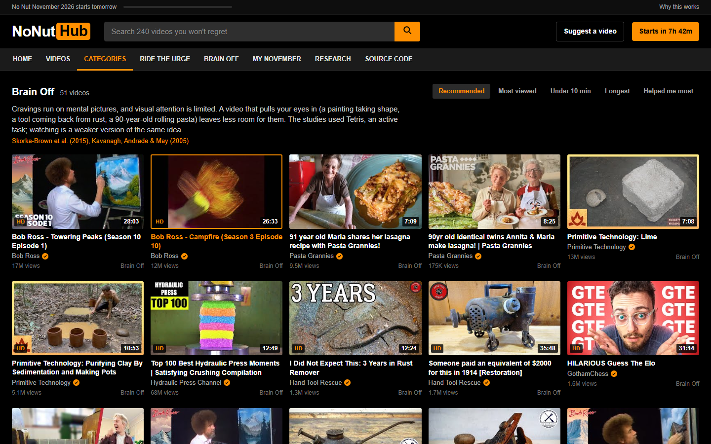

<p align="center">
  
</p>

<h3 align="center">The tab you open instead. 240 real videos that help against an urge, sorted by what the research says works, with new ones every day.</h3>

<p align="center">
  <a href="https://eneserdo.github.io/nonuthub/"></a>
  
  
  
  
  <a href="LICENSE"></a>
</p>

<p align="center">
  <a href="https://eneserdo.github.io/nonuthub/"><b>Open NoNutHub</b></a> ·
  <a href="https://github.com/eneserdo/nonuthub/actions/workflows/videos.yml">daily video update</a> ·
  <a href="https://eneserdo.github.io/nonuthub/#/watch/pXWQXDxXg5U">start with a 3 minute urge surf</a> ·
  <a href="https://eneserdo.github.io/nonuthub/#/research">read the research</a>
</p>

---

NoNutHub looks like the site you were about to open: black and orange, a search bar, a grid of thumbnails with
durations, view counts and HD badges, a player, "Up next". The videos are something else: guided urge surfing,
Wim Hof breathing, follow-along push-ups, cold-shower science, Bob Ross, Pasta Grannies, Primitive Technology,
train cab rides and talks on habits and porn. Every category is built on a published study, linked by DOI under the player.

The idea has company: Pornhub itself once launched [ScrubHub](https://www.timeout.com/hong-kong/news/pornhub-releases-scrubhub-a-parody-site-filled-with-handwashing-videos-042120),
a safe-for-work copy of its site with only hand-washing videos, and blockers like the
[NoFap Panic Button](https://chrome.google.com/webstore/detail/nofap-panic-button/dgoanlacpjfionnlbhnecopndppgbkfo) and
[Focus Guard](https://microsoftedge.microsoft.com/addons/detail/jbpbgajidbalefbfcokpkleefeeobcnp) swap adult pages for
motivational videos. NoNutHub puts the swap where the habit already goes, and sorts the videos by what the research supports.

## Preview

<table>
  <tr>
    <td width="50%"><br><sub><b>Home.</b> The familiar grid with real videos. Hovering a thumbnail flips through frames of the video.</sub></td>
    <td width="50%"><br><sub><b>Watch page.</b> YouTube's own player loads on click; below it, why this category helps and the studies.</sub></td>
  </tr>
  <tr>
    <td><br><sub><b>Categories.</b> Each one says which study it rests on and what that study did and did not show.</sub></td>
    <td><br><sub><b>Search.</b> Whatever you type, you get these instead.</sub></td>
  </tr>
  <tr>
    <td><br><sub><b>Research.</b> Thirteen studies with DOI, what each found, which category uses it.</sub></td>
    <td><br><sub><b>My November.</b> 30-day calendar and an if-then plan. A slip resets the streak, never the clean days.</sub></td>
  </tr>
</table>

<p align="center">
  &nbsp;&nbsp;&nbsp;
  
</p>

## The videos

36 hand-picked videos (below) plus a daily list of about 200 more that [`tools/fetch_videos.py`](tools/fetch_videos.py) finds
every morning with a [GitHub Actions job](.github/workflows/videos.yml). The fetcher searches YouTube in restricted
mode with fixed queries per category, keeps videos from trusted channels (or, in open categories, popular videos with a
clean title), checks that the owner allows embedding, filters reupload channels and words like "hot", "asmr" or "dating",
and writes [`docs/videos.json`](docs/videos.json). The site scrolls endlessly through both lists.

The hand-picked ones:

| Category | Videos |
|---|---|
| **Ride the Urge** | [Urge Surfing Meditation](https://eneserdo.github.io/nonuthub/#/watch/dHzS_RBtnXE) (Eating Recovery Center, 7:54)<br>[3-Minute Urge Surfing Mindfulness Meditation](https://eneserdo.github.io/nonuthub/#/watch/pXWQXDxXg5U) (Kernel of Wisdom - Mental Health & Mindfulness, 3:29)<br>[Guided Meditation for Urges (No Music, Voice Only, 10 Mins)](https://eneserdo.github.io/nonuthub/#/watch/RJ8cQm3Lzh8) (Declutter The Mind, 11:19) |
| **Breathe** | [Guided Wim Hof Method Breathing](https://eneserdo.github.io/nonuthub/#/watch/tybOi4hjZFQ) (Wim Hof, 11:00)<br>[Wim Hof Method Guided Breathing for Beginners (3 Rounds Slow Pace)](https://eneserdo.github.io/nonuthub/#/watch/0BNejY1e9ik) (Wim Hof, 11:00)<br>[5 Minutes Box Breathing Relaxation Exercise – Beginner Pace – Anxiety Reduction Pranayama Technique](https://eneserdo.github.io/nonuthub/#/watch/oN8xV3Kb5-Q) (Hands-On Meditation, 6:53)<br>[5 Minute Box Breathing Exercise to Release Stress](https://eneserdo.github.io/nonuthub/#/watch/LwUyeKUred8) (Pocket Breath Coach - Luke Horton, 5:01) |
| **Sweat It Out** | [Guided 100 Push Up Workout!](https://eneserdo.github.io/nonuthub/#/watch/b5e8QwnKAP0) (Jordan Yeoh Fitness, 9:46)<br>[100 Pushups Workout – Do This Everyday](https://eneserdo.github.io/nonuthub/#/watch/ypxmdLxCK7k) (THENX, 9:28)<br>[10-Minute Fast Walking Workout With Tanner Courtad](https://eneserdo.github.io/nonuthub/#/watch/KaIeBaxzIqs) (PS Fit, 9:52)<br>[10 Minute Beginner Full Body Stretch](https://eneserdo.github.io/nonuthub/#/watch/LnCQ-MECZSw) (Bob & Brad, 10:52) |
| **Cold Water** | [Can Cold Showers Actually Change Your Life?](https://eneserdo.github.io/nonuthub/#/watch/HsonXuJs8-s) (SciShow, 4:12)<br>[What Happens To Body After 30 Days Cold Showers (Science Explained)](https://eneserdo.github.io/nonuthub/#/watch/fxICyViHCSw) (Jeremy Ethier, 9:40)<br>[Deliberate Cold Exposure — How to Do it RIGHT with Dr. Andrew Huberman – The Proof Podcast EP 205](https://eneserdo.github.io/nonuthub/#/watch/2XecbuI-9QE) (The Proof with Simon Hill, 5:52)<br>[Wim Hof's Top 10 reasons to take cold showers & ice baths 🧊](https://eneserdo.github.io/nonuthub/#/watch/7FlmpnsbciQ) (Wim Hof, 8:08) |
| **Brain Off** | [Bob Ross - Towering Peaks (Season 10 Episode 1)](https://eneserdo.github.io/nonuthub/#/watch/1s58rW0_LN4) (Bob Ross, 28:03)<br>[Bob Ross - Campfire (Season 3 Episode 10)](https://eneserdo.github.io/nonuthub/#/watch/L5bXkI0-pEg) (Bob Ross, 26:33)<br>[91 year old Maria shares her lasagna recipe with Pasta Grannies!](https://eneserdo.github.io/nonuthub/#/watch/4UTrEpVKhKM) (Pasta Grannies, 7:09)<br>[90yr old identical twins Annita & Maria make lasagna! – Pasta Grannies](https://eneserdo.github.io/nonuthub/#/watch/L6RDHiazUWo) (Pasta Grannies, 8:25)<br>[Primitive Technology: Lime](https://eneserdo.github.io/nonuthub/#/watch/Ek3aeUhHaFY) (Primitive Technology, 7:08)<br>[Primitive Technology: Purifying Clay By Sedimentation and Making Pots](https://eneserdo.github.io/nonuthub/#/watch/k2RKtUh6m3Q) (Primitive Technology, 10:53)<br>[Top 100 Best Hydraulic Press Moments – Satisfying Crushing Compilation](https://eneserdo.github.io/nonuthub/#/watch/q9BtYEnrkg4) (Hydraulic Press Channel, 12:49)<br>[I Did Not Expect This: 3 Years in Rust Remover](https://eneserdo.github.io/nonuthub/#/watch/7gsghuBZm_w) (Hand Tool Rescue, 12:24)<br>[Someone paid an equivalent of $2000 for this in 1914 [Restoration]](https://eneserdo.github.io/nonuthub/#/watch/rw_8FWJuSho) (Hand Tool Rescue, 35:48)<br>[HILARIOUS Guess The Elo](https://eneserdo.github.io/nonuthub/#/watch/739ZErzO34U) (GothamChess, 31:14)<br>[This machine breaks things.](https://eneserdo.github.io/nonuthub/#/watch/-E47v4Oy7fE) (Tom Scott, 23:17) |
| **Touch Grass** | [Train Driver view – Bernina Express Line Switzerland – Cab ride 4K 60p HDR](https://eneserdo.github.io/nonuthub/#/watch/vh-QpuWuiEo) (AKSense - Zurich, 28:26)<br>[The Most Beautiful Nature Walk in Scotland l Walking Tour 4K HDR 60fps](https://eneserdo.github.io/nonuthub/#/watch/FQkekOTMFPg) (Scotland's Wild, 1:04:50)<br>[Walking in the Rain through Old Growth Forest – Yakushima, Japan](https://eneserdo.github.io/nonuthub/#/watch/-qPcvFVB-yg) (Ambient Exploration, 1:07:46) |
| **Why Quit** | [A Simple Way to Break a Bad Habit – Judson Brewer – TED](https://eneserdo.github.io/nonuthub/#/watch/-moW9jvvMr4) (TED, 9:25)<br>[Why is it so hard to break a bad habit?](https://eneserdo.github.io/nonuthub/#/watch/wr6fQ4KpbRM) (TED-Ed, 5:04)<br>[Why I stopped watching porn – Ran Gavrieli – TEDxJaffa](https://eneserdo.github.io/nonuthub/#/watch/gRJ_QfP2mhU) (TEDx Talks, 15:58)<br>[Pornography Isn't Your Problem – Jason Mahr – TEDxCincinnati](https://eneserdo.github.io/nonuthub/#/watch/vIgWMzdgweI) (TEDx Talks, 7:09)<br>[Dopamine Nation: Finding Balance in the Age of Indulgence with Anna Lembke](https://eneserdo.github.io/nonuthub/#/watch/n2u8Z1HeKD8) (Stanford Alumni, 13:27)<br>[Improve Your Baseline Dopamine for Motivation & Drive – Dr. Andrew Huberman](https://eneserdo.github.io/nonuthub/#/watch/35lS7gJVTyA) (Huberman Lab Clips, 8:04)<br>[What sex ed doesn’t tell you about your brain - Shannon Odell](https://eneserdo.github.io/nonuthub/#/watch/deNGkzUlhZU) (TED-Ed, 5:09) |

## What the research says

The full table with findings is on the [research page](https://eneserdo.github.io/nonuthub/#/research). In short:

- **Urges pass.** Urge surfing did not make urges weaker in the moment, but people acted on them less over the next week
  ([Bowen & Marlatt 2009](https://doi.org/10.1037/a0017127)).
- **Pictures fuel cravings, and a visual task competes with them.** Three minutes of Tetris lowered craving strength by
  13.9 points out of 100 in daily life, including cravings for sex ([Skorka-Brown et al. 2015](https://doi.org/10.1016/j.addbeh.2015.07.020);
  [Kavanagh et al. 2005](https://doi.org/10.1037/0033-295X.112.2.446)).
- **Moving helps fast.** Every exercise-versus-sitting study in one review found fewer cravings, from 5 minutes of
  isometric work or 15 minutes of light walking, lasting up to 50 minutes ([Taylor et al. 2007](https://doi.org/10.1111/j.1360-0443.2006.01739.x)).
- **Plans beat intentions, situations beat willpower.** If-then plans had an effect of d = 0.65 across 94 tests
  ([Gollwitzer & Sheeran 2006](https://doi.org/10.1016/S0065-2601(06)38002-1)); changing the situation works better than resisting in it
  ([Duckworth et al. 2016](https://doi.org/10.1177/1745691615623247)).
- **Habits take longer than a month.** Median 66 days, range 18 to 254, and one missed day did not reset progress
  ([Lally et al. 2010](https://doi.org/10.1002/ejsp.674)).
- **Shame makes it worse.** Feeling addicted to porn tracks moral incongruence more than actual use
  ([Grubbs et al. 2019](https://doi.org/10.1007/s10508-018-1248-x)).
- **The famous reason is gone.** The "testosterone peaks at 145.7% on day 7" study was retracted in 2021
  ([Jiang et al. 2003](https://doi.org/10.1631/jzus.2003.0236)), and short porn abstinence is barely studied
  ([Fernandez et al. 2020](https://doi.org/10.1016/j.cpr.2020.101828)).

Every DOI on this page and on the site was checked against Crossref and PubMed.

## How it works

Plain HTML, CSS and JavaScript modules in [`docs/`](docs), served by GitHub Pages. No framework, no build step.
Thumbnails come from `i.ytimg.com`; the player is YouTube's embed and loads only when you press play. It uses
`youtube.com/embed`, so a YouTube login in the same browser counts and YouTube's "confirm you're not a bot" check
(which mostly hits VPN connections) appears less often. When it does appear, the page explains it and links to YouTube.

```
docs/
  index.html      header, navigation, entry dialog, footer
  style.css       the black and orange theme
  data.js         the 13 studies, 7 categories and 36 hand-picked videos
  videos.json     the daily list from tools/fetch_videos.py
  app.js          hash router, grid, player, search, research table, November tracker
  readme/         banner source and the screenshots in this README
tools/
  fetch_videos.py   daily search: queries, trusted channels and filters per category
  videos_meta.json  video ids, titles and channels (YouTube oEmbed), lengths and views (YouTube search), 2026-10-31
  serve.py        local server with the right MIME types
  shots.py        clicks through every page in Chrome, fails on console errors, renders the README images
```

Only videos whose owners allow embedding are listed (checked with YouTube's oEmbed endpoint). Nothing is downloaded or
re-hosted: views go to the channels that made the videos. Votes, your if-then plan and your November calendar are
stored in `localStorage` and never leave the browser.

## Development

```sh
python tools/serve.py 8090      # http://127.0.0.1:8090/
python tools/shots.py           # smoke test + README images (needs: pip install playwright)
python tools/fetch_videos.py    # refresh docs/videos.json by hand
```

Suggest a video: [open an issue](https://github.com/eneserdo/nonuthub/issues/new) with the YouTube link and the category
it belongs in.

## Notes

- A parody of tube-site design for No Nut November. No adult content, no adult links. Not affiliated with,
  endorsed by or connected to any adult website; the logo and all code here are original.
- Not medical advice. Masturbation is not harmful. If porn or masturbation feels out of your control or hurts your
  life, talk to a doctor or a counsellor.
- The videos belong to their channels and are shown with YouTube's embed player. The personal talks in Why Quit are
  opinions, not evidence; the research page says what the studies show.

## License

MIT, see [`LICENSE`](LICENSE).
